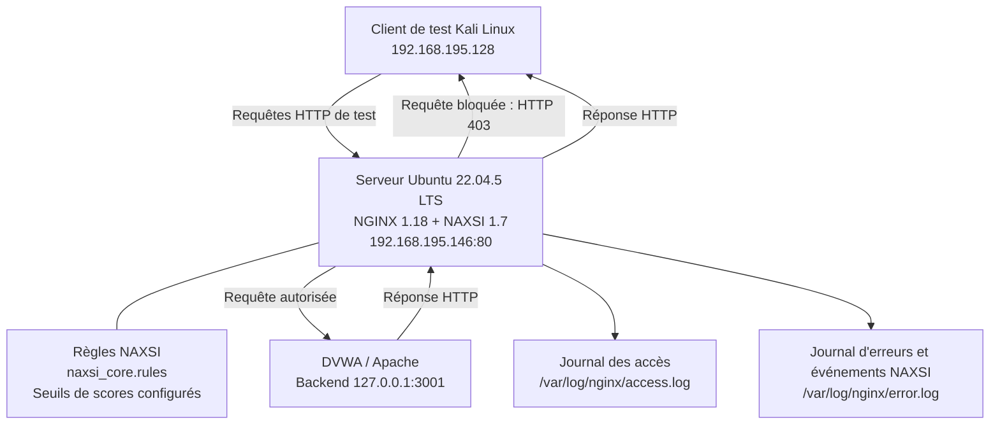

# Architecture — WAF NGINX + NAXSI

## 1. Présentation du projet

Ce projet déploie un Web Application Firewall (WAF) devant une application web DVWA. NGINX agit comme reverse proxy et NAXSI inspecte les requêtes HTTP afin de détecter et bloquer des motifs d'attaque web.

Le laboratoire couvre des scénarios contrôlés de SQL Injection (SQLi), Cross-Site Scripting (XSS), traversal/LFI, requêtes de type RFI et techniques d'évasion. Les événements sont examinés dans les journaux NGINX et une première comparaison des temps de réponse est effectuée.

## 2. Architecture logique



### Flux de traitement

1. Le client de test envoie une requête HTTP à NGINX sur le port 80.
2. NAXSI inspecte la requête à l'aide des règles activées et attribue des scores aux motifs détectés.
3. Si un seuil configuré est atteint, la requête est bloquée et le client reçoit une réponse HTTP 403.
4. Si la requête est autorisée, NGINX la transmet à DVWA sur `127.0.0.1:3001`.
5. Les accès et événements de sécurité sont consignés dans les journaux.

## 3. Composants et adresses

| Composant | Configuration | Rôle |
|---|---|---|
| Client de test | Kali Linux — `192.168.195.128` | Émet les requêtes de test |
| Serveur WAF | Ubuntu Server 22.04.5 LTS — `192.168.195.146` | Héberge NGINX et NAXSI |
| NGINX | `1.18.0-6ubuntu14.21`, port 80 | Point d'entrée HTTP et reverse proxy |
| NAXSI | Module dynamique version 1.7 | Inspection et filtrage des requêtes HTTP |
| Règles principales | `/etc/nginx/naxsi/naxsi_core.rules` | Règles de détection NAXSI |
| Configuration du site | `/etc/nginx/sites-available/waf` | Configuration du reverse proxy et des seuils |
| Application backend | DVWA / Apache — `127.0.0.1:3001` | Application web de laboratoire |
| Journal des accès | `/var/log/nginx/access.log` | Requêtes, URI et codes HTTP |
| Journal d'erreurs | `/var/log/nginx/error.log` | Messages d'erreur et événements NAXSI |

Le backend est configuré sur l'interface de boucle locale. Le client Kali accède normalement à l'application par le port 80 du serveur WAF, et non directement au port du backend.

## 4. Configuration de sécurité

Les seuils de blocage configurés dans le laboratoire sont :

| Catégorie | Seuil |
|---|---:|
| SQL | `$SQL >= 8` |
| XSS | `$XSS >= 8` |
| RFI | `$RFI >= 8` |
| Traversal | `$TRAVERSAL >= 5` |
| Évasion | `$EVADE >= 4` |

La décision de blocage dépend des scores attribués par les règles déclenchées et des seuils configurés. Une règle déclenchée est un événement à analyser ; elle ne prouve pas à elle seule qu'une attaque a réussi.

La configuration comprend également une URI interne de refus :

```nginx
location = /RequestDenied {
    internal;
    return 403;
}
```

Cette URI est prévue pour un usage interne à NGINX et n'est pas destinée à être une page publique directement accessible.

> Avant de réutiliser cette configuration ailleurs, vérifier le fichier NGINX réellement actif ainsi que les chemins et seuils effectivement chargés.

## 5. Scénarios de sécurité testés

| Scénario | Résultat observé |
|---|---|
| SQL Injection (SQLi) | Événement NAXSI avec `$SQL=22`, règles 1009 et 1013, `config=block` |
| XSS réfléchi | HTTP 403 ; score `$XSS=8`, règle 1010 |
| Traversal / test LFI | HTTP 403 ; score `$TRAVERSAL` observé jusqu'à 16, règle 1200 |
| Requête de type RFI | HTTP 403 ; score `$RFI=8`, règle 1100 |
| Test d'évasion `%25U` | HTTP 403 ; score `$EVADE=4`, règle 1401 |
| Chemin doublement encodé | Règle 1315 déclenchée ; événement classé dans les scores XSS lors du test |

Ces résultats montrent que les requêtes de test citées ont été détectées et bloquées dans la configuration observée. Ils ne démontrent pas que toutes les variantes de ces attaques seront bloquées.

## 6. Journalisation et analyse

Les journaux principaux sont :

- `/var/log/nginx/access.log` : URI, codes HTTP et traces des accès.
- `/var/log/nginx/error.log` : erreurs NGINX et événements NAXSI, notamment ceux contenant `NAXSI_FMT`.

Commandes utiles :

```bash
# Examiner les dernières requêtes
sudo tail -n 50 /var/log/nginx/access.log

# Afficher les événements NAXSI
sudo grep 'NAXSI_FMT' /var/log/nginx/error.log

# Compter les occurrences NAXSI présentes dans le journal
sudo grep -c 'NAXSI_FMT' /var/log/nginx/error.log

# Compter les événements de blocage consignés
sudo grep 'NAXSI_FMT' /var/log/nginx/error.log | grep -c 'config=block'

# Vérifier la configuration NGINX
sudo nginx -t
```

Pendant l'analyse de la phase 6, `grep -c 'NAXSI_FMT'` a renvoyé **39**. Ce nombre correspond aux occurrences trouvées à ce moment-là dans le journal consulté ; il ne représente pas nécessairement 39 attaques uniques.

Trois requêtes de contrôle considérées comme bénignes n'ont pas produit d'événement de blocage identifié dans l'échantillon examiné. Cette observation limitée ne prouve pas l'absence générale de faux positifs.

## 7. Première campagne de mesure des performances

Une première campagne a comparé 30 requêtes vers le backend direct et 30 requêtes via NGINX + NAXSI. Les mesures ont été réalisées depuis le serveur Ubuntu avec `curl`.

| Indicateur | Backend direct | Via le WAF |
|---|---:|---:|
| Nombre de requêtes | 30 | 30 |
| Temps moyen | 7,1 ms | 10,3 ms |
| Temps minimum | 2,1 ms | 3,0 ms |
| Temps maximum | 67,9 ms | 118,8 ms |
| Codes HTTP observés | HTTP 302 pour les 30 requêtes | HTTP 302 pour les 30 requêtes |

À partir des moyennes affichées :

- Écart moyen observé : **environ 3,2 ms**.
- Surcoût relatif estimé : **environ 45,1 %**.

Le pourcentage est indicatif, car il est calculé à partir de moyennes arrondies et les temps mesurés varient d'une requête à l'autre.

Toutes les réponses ont été des redirections HTTP 302, cohérentes avec le comportement de connexion de DVWA. Ces résultats fournissent une première référence, mais ne mesurent pas le chargement complet d'une page authentifiée. Ils ne permettent pas non plus d'isoler le coût propre de NAXSI par rapport à NGINX, au reverse proxy et au backend.

Pour consolider les conclusions, il est recommandé de répéter plusieurs séries, de mesurer la même ressource retournant HTTP 200, de calculer la médiane et le P95, et de surveiller l'utilisation CPU et mémoire pendant les essais.

## 8. Limites et recommandations

- Garder DVWA dans un environnement de laboratoire isolé.
- Ne réaliser des tests que sur des systèmes détenus ou explicitement autorisés.
- Corréler le code HTTP, la requête et l'événement NAXSI correspondant.
- Valider les seuils avec des requêtes légitimes représentatives afin de réduire le risque de faux positifs.
- Vérifier régulièrement la configuration active et les journaux après chaque modification.
- Maintenir le système, NGINX et les composants de sécurité à jour.
- Ne pas considérer les tests réalisés comme une certification de sécurité ou une garantie contre toutes les attaques.

## 9. Conclusion

Le laboratoire met en place une architecture de défense composée de NGINX comme point d'entrée HTTP, de NAXSI pour l'inspection et le blocage des requêtes, de DVWA comme application backend de test et des journaux pour l'analyse des événements.

Plusieurs scénarios contrôlés ont été bloqués et consignés. Une première campagne de mesures a fourni une référence initiale des temps de réponse, qui doit être consolidée par des essais complémentaires.

**État du projet :** architecture déployée dans le laboratoire, tests de détection et de blocage exécutés, journalisation analysée et première campagne de performance réalisée. Les résultats restent limités au périmètre et aux conditions de ce laboratoire.
